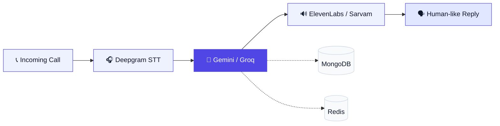

<div align="center">


<br><br>

<a href="https://github.com/KhushalYadav535"></a>
<a href="https://github.com/KhushalYadav535?tab=followers"></a>


<br><br>

*“People don't remember code. They remember the impact it created.”*

**Build · Learn · Share · Repeat** — from Prayagraj to the world 🇮🇳

</div>

<br>

## 👋 About

I'm an **AI Engineer & technical founder** based in Prayagraj, working at **Sentient Digital (Indore)**. I studied B.Tech CSE at BBDNITM, Lucknow, and I love building low-latency voice AI and full-stack products end to end — architecture, code, and deployment.

|  |  |
|---|---|
| 🎙️ **Flagship** | Vaani AI — multi-tenant Hindi/Hinglish voice agents |
| 🛠️ **How I work** | Solo full-stack: idea → code → Docker + Traefik + Coolify on VPS |
| 🧠 **Obsessed with** | STT → LLM → TTS latency & per-call cost |
| 📈 **Track record** | 1000+ commits · 110+ public repos · shipping every week |

<br>

## ⚡ Tech Stack

<div align="center">

<br>


<br>


</div>

<br>

## 🎙️ Spotlight — Vaani AI

> **India's multilingual voice AI platform.** Multi-tenant voice agents in Hindi / Hinglish for support & sales. Real-time **STT → LLM → TTS** in one low-latency pipeline. Every client gets its own persona, system prompt and voice — on one shared infra for cost efficiency.

✔ Hindi grammatical-gender agreement fix  ·  ✔ TTS cost cut, quality intact  ·  ✔ Redis sessions + MongoDB tenants



<br>

## 📦 Selected Work

| | |
|---|---|
| 🍕 **Gaon Zaika** — *Swad Gaon Ka*<br>Full food-delivery ecosystem: customer app, restaurant panel, live tracking, admin. Shipped solo.<br>`React Native` `Expo` `Node.js` `MongoDB` | 🏢 **AapkiSociety**<br>Society management app + backend — complaints, notices, billing, daily ops.<br>`React Native` `Node.js` |
| 📈 **Avadh15 / Tradebackend**<br>Virtual trading simulator with a hardened auth & portfolio layer over live sockets.<br>`Node.js` `WebSockets` `Redis` | 🌾 **TextMitra**<br>Hindi + English OCR backend for scans, invoices & forms.<br>`Python` `Flask` `PaddleOCR` |

<div align="center">


<br>


</div>

<br>

## 📊 GitHub Stats

<div align="center">


</div>

<br>

## 🐍 Contribution Snake

<div align="center">


</div>

<br>

## 🌍 Journey

```text
2023 ── Learning programming        HTML · CSS · JavaScript
2024 ── Frontend + Backend          React · Node.js · MongoDB
2025 ── Full-Stack Engineer         Production apps · Docker · VPS
2026 ── AI Engineer @ Sentient      Voice AI · LLMs · Multi-tenant SaaS → shipping Vaani AI 🚀
Next ── Founder                     Scaling AI products to millions
```

<details>
<summary><b>What are you focused on right now?</b></summary>
<br>
Scaling Vaani AI — lower latency, lower per-call cost, more clients on the multi-tenant platform.
</details>

<details>
<summary><b>Go-to stack for a new product?</b></summary>
<br>
React / React Native + Node.js/Express + MongoDB/Postgres, Dockerized behind Traefik via Coolify. Python (Flask/FastAPI) for AI/OCR services.
</details>

<details>
<summary><b>Open to work / collab?</b></summary>
<br>
Yes — Voice AI, SaaS, automation. Email or LinkedIn below. Hindi & English both OK.
</details>

<br>

## 🔗 Let's Connect

<div align="center">

<a href="https://github.com/KhushalYadav535"></a>
<a href="https://www.linkedin.com/in/khushal-yadav-27a178220"></a>
<a href="mailto:khushalyadavofficial@gmail.com"></a>

<br><br>

**⭐ Follow along — new voice-AI builds every week.**


</div>
